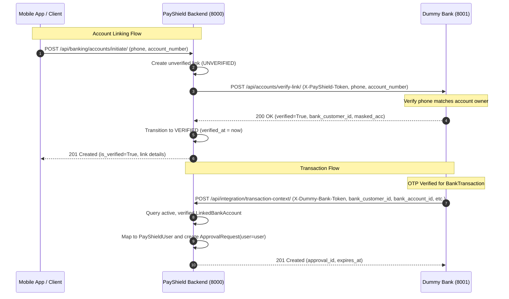

# PayShield — Phase 2: Customer Identity & Bank Account Linking

This document details the architectural foundation implemented in Phase 2 for securely connecting customer identity, linked bank accounts, and transaction contexts across **PayShield** and **Dummy Bank**.

---

## 1. Architectural Overview & Trust Boundary

PayShield operates as an independent transaction authorization layer designed to stop OTP-intercepted fraud. 

### The Trust Boundary
- **Mobile Client**: The mobile client is strictly an untrusted presentation layer. It **never** receives server-to-server authentication tokens (`X-PayShield-Token`, `X-Dummy-Bank-Token`) and cannot unilaterally assert ownership of an external bank account or approve unassigned transactions.
- **PayShield Backend (Port 8000)**: Maintains customer identity (`PayShieldUser`) keyed to a verified primary mobile number. Tracks external bank accounts via `LinkedBankAccount` records that are independently validated.
- **Dummy Bank Backend (Port 8001)**: The authoritative banking simulator. Manages customer accounts (`BankCustomer`, `BankAccount`), verifies banking transaction OTPs, and verifies account ownership through private server-to-server endpoints.



---

## 2. Data Models and Relationships

### PayShield Backend (`backend/`)

#### A. `PayShieldUser` (`backend/accounts/models.py`)
Links a primary registered phone number to Django's standard authentication framework.
- `user`: `OneToOneField(auth.User)` — Enables standard Django sessions, DRF tokens, and permissions.
- `phone_number`: `CharField(max_length=15, unique=True, db_index=True)` — Primary customer identifier.
- `is_phone_verified`: `BooleanField(default=False)` — Login OTP verification state.
- `is_active`: `BooleanField(default=True)` — Administrative active flag.
- Timestamps: `created_at`, `updated_at`.

#### B. `LoginOTPChallenge` (`backend/accounts/models.py`)
Dedicated login OTP model for PayShield authentication (completely separate from Dummy Bank's transaction `OTPChallenge`).
- `challenge_id`: `BigAutoField(primary_key=True)`
- `phone_number`: `CharField(max_length=15, db_index=True)`
- `otp_hash`: `CharField(max_length=255)` — Cryptographic hash (PBKDF2/Argon2).
- `expires_at`: `DateTimeField()`
- `attempts`: `PositiveSmallIntegerField(default=0)`
- `max_attempts`: `PositiveSmallIntegerField(default=3)`
- `status`: `PENDING`, `VERIFIED`, `EXPIRED`, `LOCKED`, `INVALID`

#### C. `LinkedBankAccount` (`backend/banking/models.py`)
Privacy-preserving link to an external bank account.
- `link_id`: `BigAutoField(primary_key=True)`
- `user`: `ForeignKey(PayShieldUser, related_name="linked_bank_accounts")` — Allows one user to link multiple bank accounts.
- `bank_name`: `CharField(max_length=100, default="PayShield Demo Bank")`
- `bank_customer_id`: `UUIDField(db_index=True)` — BankCustomer UUID provided by issuing bank.
- `bank_account_id`: `BigIntegerField(db_index=True)` — BankAccount primary key.
- `account_number_masked`: `CharField(max_length=30)` — e.g. `********0001` (never raw full account numbers).
- `account_type`: `CharField(max_length=20, default="SAVINGS")`
- `is_verified`: `BooleanField(default=False)` — Rule 8: Links begin unverified.
- `verification_status`: `UNVERIFIED`, `VERIFIED`, `FAILED`, `REVOKED`
- `is_active`: `BooleanField(default=True)`
- Constraint: `UniqueConstraint(fields=["bank_name", "bank_account_id"])` — Prevents duplicate links across accounts.

#### D. `TransactionContext` Updates (`backend/transactions/models.py`)
Added trusted banking references:
- `bank_customer_id`: `UUIDField(null=True, blank=True, db_index=True)`
- `bank_account_id`: `BigIntegerField(null=True, blank=True, db_index=True)`
- `sender_account_masked`: `CharField(max_length=30, blank=True)`
- `linked_account`: `ForeignKey(LinkedBankAccount, null=True, blank=True, on_delete=SET_NULL)`
- `user`: `ForeignKey(PayShieldUser, null=True, blank=True, on_delete=SET_NULL)`

#### E. `ApprovalRequest` Updates (`backend/authorization/models.py`)
- `user`: `ForeignKey(PayShieldUser, null=True, blank=True, on_delete=SET_NULL)` — Enables fast, indexed lookup for customer-scoped approvals in Phase 3.

---

## 3. API Endpoints

### Dummy Bank Backend (Port 8001)

| Method | Endpoint | Auth Header | Description |
|---|---|---|---|
| `POST` | `/api/accounts/verify-link/` | `X-PayShield-Token` | Validates bank account ownership against registered customer phone number. Returns masked metadata and customer UUID. |
| `POST` | `/api/otp/verify/` | None (Client OTP) | Verifies OTP and now includes `bank_customer_id`, `bank_account_id`, and `sender_account_masked` in transaction context sent to PayShield. |

### PayShield Backend (Port 8000)

| Method | Endpoint | Description |
|---|---|---|
| `GET` | `/api/banking/accounts/` | Lists all linked accounts for a user (`?phone_number=...` or auth session). |
| `POST` | `/api/banking/accounts/initiate/` | Initiates linking of a bank account in `UNVERIFIED` state (Rule 8). |
| `POST` | `/api/banking/accounts/<id>/verify/` | Confirms link verification with Dummy Bank and marks status `VERIFIED`. |
| `POST` | `/api/banking/accounts/link-and-verify/` | One-shot convenience endpoint for linking and validating in one step. |
| `POST` | `/api/integration/transaction-context/` | Validates `X-Dummy-Bank-Token`, extracts bank identifiers, resolves matching verified `LinkedBankAccount`, and creates user-associated `ApprovalRequest`. |

---

## 4. Database Migrations

All migrations were created without deleting or resetting existing database tables:

### Backend
1. `accounts.0001_initial`: Creates `LoginOTPChallenge` and `PayShieldUser`.
2. `banking.0001_initial`: Creates `LinkedBankAccount` with uniqueness constraint.
3. `transactions.0002_transactioncontext_bank_account_id_and_more`: Adds `bank_customer_id`, `bank_account_id`, `sender_account_masked`, `linked_account`, and `user` as nullable fields.
4. `authorization.0002_approvalrequest_user`: Adds `user` as nullable foreign key.

```bash
# Backend migration commands
python manage.py makemigrations
python manage.py migrate
```

---

## 5. Prototype vs Real-World Banking Integration

| Feature | Student Prototype (Dummy Bank) | Real-World Production Architecture |
|---|---|---|
| **Account Ownership Verification** | Server-to-server phone number cross-check via shared API token | Open Banking APIs (e.g. UK Open Banking, India Account Aggregator / Sahamati, PSD2). Cryptographic signed consent artifacts. |
| **Service Authentication** | Static shared secret tokens (`X-PayShield-Token`, `X-Dummy-Bank-Token`) via HTTPS headers | Mutual TLS (mTLS), asymmetric key exchange (JWKS), or OAuth 2.0 client credentials with IP allowlisting. |
| **Transaction Context Push** | Webhook HTTP POST on port 8000 | Secure webhook with HMAC-SHA256 signature header (`X-Signature-SHA256`) and replay prevention via timestamps and nonces. |
| **Data Minimization** | Stores customer UUID, account ID, masked account number | Compliant with RBI / GDPR / data protection regulations; zero storage of account balances, passwords, or transaction OTPs. |

