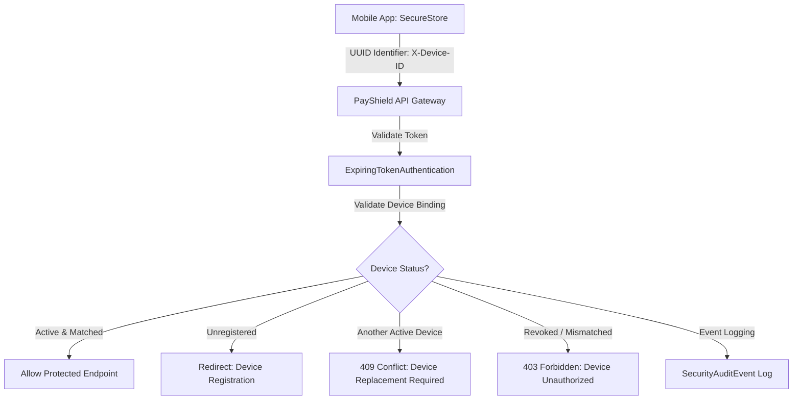
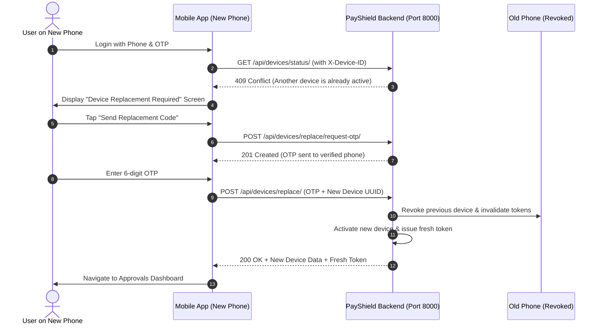

# PayShield — Phase 5: Device Registration & Device Binding Documentation

## 1. Overview & Architecture

PayShield introduces device registration and device binding to enforce a strict **one-active-device policy** per customer account. Even if an attacker compromises a user's login credentials or transaction OTP, transactions cannot be approved from an unauthorized, rogue, or revoked device.



---

## 2. One-Active-Device Policy

1. **Strict Exclusivity**: A PayShield account can have only **one** device with `status = "ACTIVE"` at any given time.
2. **Multiple Linked Accounts**: A single active device can monitor and authorize payments across multiple linked bank accounts (e.g. HDFC, ICICI, SBI).
3. **SIM Card Independence**: Physical SIM changes or roaming do **not** revoke device binding. PayShield binds to the persistent device instance stored in the operating system's secure keystore, not to SIM serial numbers (IMSI/ICCID).
4. **No Silent Replacements**: Registering an additional device when an active device already exists is explicitly rejected with `HTTP 409 Conflict` (`DEVICE_REPLACEMENT_REQUIRED`). Replacement requires fresh phone ownership verification.

---

## 3. Device Identification Approach vs. Hardware Attestation

### Implemented Mechanism: Device Identification
- Each mobile app installation generates an RFC 4122 v4 UUID (`device_id`).
- The UUID is stored in `expo-secure-store`:
  - **iOS**: iOS Keychain (hardware-backed encryption).
  - **Android**: Android Keystore + EncryptedSharedPreferences (AES-256 GCM).
  - **Web/Test**: In-memory and local storage fallback.
- The `X-Device-ID` HTTP header is automatically attached to every protected API request.

### Security Distinction & Limitations
> [!IMPORTANT]
> **Important Security Clarification**: The current implementation provides **device identification and session binding**, not cryptographic hardware attestation.
> - An ordinary client-generated UUID stored in SecureStore prevents unauthorized parallel logins from casual devices and web browsers.
> - However, it does not cryptographically prove that the request originated from an uncompromised hardware enclave (e.g. Apple DeviceCheck / App Attest or Android Play Integrity API with asymmetric key signing).
> - Production banking systems requiring protection against rooted/jailbroken devices or modified client runtimes should layer Android Play Integrity or Apple App Attest on top of this device binding model.

---

## 4. Device Lifecycle & Replacement Flow



### Recovery Path if Original Device is Lost or Stolen
1. Install PayShield on the new device.
2. Sign in with the registered primary mobile phone number.
3. When prompted that another device is active, tap **"Send Replacement Code to Mobile"**.
4. Enter the 6-digit verification code received on the mobile line.
5. PayShield atomically:
   - Sets the previous device status to `REVOKED` (`revocation_reason = "REPLACED_BY_USER"`).
   - Deletes all active session tokens associated with the lost phone.
   - Activates the new device as the sole authorized hardware.

---

## 5. API Endpoints Contract

### A. Device Status
- **Method & Path**: `GET /api/devices/status/`
- **Headers**: `Authorization: Token <token>`, `X-Device-ID: <uuid>` (optional)
- **Response `200 OK`**:
```json
{
  "has_active_device": true,
  "active_device": {
    "device_id": "c7a84e49-8df2-4ce1-8fa3-d1f0579e0a21",
    "device_name": "Google Pixel 8",
    "platform": "ANDROID",
    "app_version": "1.0.0",
    "status": "ACTIVE",
    "registered_at": "2026-10-30T03:15:00Z",
    "last_active_at": "2026-10-30T03:20:00Z"
  },
  "is_current_device_registered": true,
  "current_device_status": "ACTIVE"
}
```

### B. Device Registration
- **Method & Path**: `POST /api/devices/register/`
- **Headers**: `Authorization: Token <token>`
- **Payload**:
```json
{
  "device_id": "c7a84e49-8df2-4ce1-8fa3-d1f0579e0a21",
  "device_name": "Google Pixel 8",
  "platform": "ANDROID",
  "app_version": "1.0.0"
}
```
- **Response `201 Created`**: Device registered successfully.
- **Response `409 Conflict`**: If another active device already exists:
```json
{
  "error": "Another device is already registered to this PayShield account. Device replacement is required to switch devices.",
  "code": "DEVICE_REPLACEMENT_REQUIRED",
  "registered_device": {
    "device_name": "Apple iPhone 15",
    "platform": "IOS",
    "registered_at": "2026-10-29T18:00:00Z"
  }
}
```

### C. Request Replacement OTP
- **Method & Path**: `POST /api/devices/replace/request-otp/`
- **Headers**: `Authorization: Token <token>`
- **Response `201 Created`**:
```json
{
  "message": "Verification code sent to registered mobile number for device replacement.",
  "phone_number": "9000000001",
  "expires_in_seconds": 300,
  "dev_otp": "492015"
}
```

### D. Execute Device Replacement
- **Method & Path**: `POST /api/devices/replace/`
- **Headers**: `Authorization: Token <token>`
- **Payload**:
```json
{
  "otp": "492015",
  "device_id": "f5b21e89-1df4-4be2-9ac4-e2f0689e0b32",
  "device_name": "Samsung Galaxy S24",
  "platform": "ANDROID",
  "app_version": "1.0.0"
}
```
- **Response `200 OK`**:
```json
{
  "message": "Device replaced successfully. Previous device sessions have been revoked.",
  "device": { ... },
  "token": "4a7f9b8c2d1e0f3a6b5c4d3e2f1a0b9c8d7e6f5a"
}
```

### E. Revoke Device
- **Method & Path**: `POST /api/devices/revoke/`
- **Headers**: `Authorization: Token <token>`
- **Payload**: `{ "device_id": "<uuid>", "reason": "USER_REQUESTED" }` (optional)
- **Response `200 OK`**: Device revoked, current session invalidated.
- **Response `403 Forbidden`**: If attempting to revoke another user's device (`PERMISSION_DENIED`).

---

## 6. Audit Logging

Security-critical actions are recorded in the `SecurityAuditEvent` model (`audit_securityauditevent` table) with:
- `event_type`: `DEVICE_REGISTERED`, `REGISTRATION_REJECTED`, `DEVICE_REPLACED`, `DEVICE_REVOKED`, `DEVICE_UNAUTHORIZED_REQUEST`.
- `user`: ForeignKey to `PayShieldUser`.
- `device_id`: Character representation of UUID.
- `ip_address`: Remote client IP.
- `user_agent`: Browser or Expo client string.
- `details`: Non-sensitive context dictionary (passwords, OTPs, auth tokens, and bank secrets are scrubbed).

